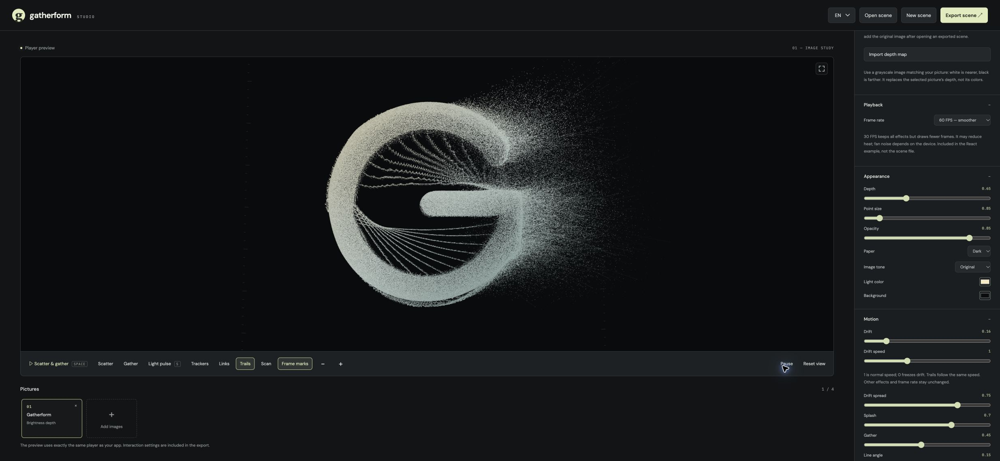
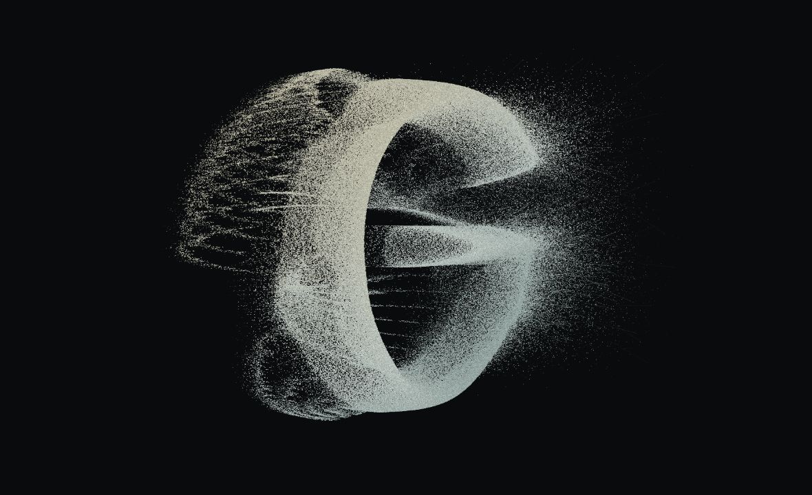

# Gatherform

**Turn an image into an interactive particle visualization. Design it in Studio, export a scene, and play it in your own app.**

[Try Studio](https://armineslami.github.io/gatherform/) · [How to install](#how-to-install) · [Props](#props) · [React player](packages/react/README.md) · [Core API](packages/core/README.md) · [Performance](docs/performance.md) · [MIT license](LICENSE)



Gatherform is a browser-based editor and a reusable WebGL player. It turns logos,
illustrations and photos into point clouds that visitors can rotate, zoom, pan,
scatter and gather. Pointer movement disturbs the particles; optional trails,
trackers, frame marks and scan effects add movement and detail.

Exported scenes remain interactive. They are data files, not videos, and do not
need Studio running in the background.

## Try Studio

Open **[the hosted Studio](https://armineslami.github.io/gatherform/)** and choose
**Load demo** to try it immediately, or upload your own image. Image preparation
runs on your device. There is no account, backend or API key.

To run it locally, install **Node.js 24 or newer** and the pnpm version pinned in
`package.json`, then:

```sh
git clone https://github.com/armineslami/gatherform.git
cd gatherform
pnpm install
pnpm dev
```

Open the address printed by Vite, normally `http://127.0.0.1:5173/`.
To test from a phone or another computer on the same network, run:

```sh
pnpm --filter @armin-eslami/gatherform-studio dev --host 0.0.0.0
```

Open the network address Vite prints on that device. Both devices must be on the
same network, and your firewall must allow the connection.

## Design → export → embed

1. Load the demo or add up to four images. Transparent image backgrounds work well for logos.
2. Adjust depth, point size, opacity, drift, spread, speed and optional overlays.
3. Choose the interactions visitors can use: pointer response, rotation, zoom, pan and click-to-scatter.
4. Select **Export scene**. Choose compact or full detail, and copy a React example.
5. Put the `.gatherform` file in your app’s `public/visualizations/` directory.
6. Render it with the player. Reopen an exported scene in Studio to edit its saved settings.

English and Persian interfaces are included, with a mobile layout and zoom buttons.
Shift + drag pans when rotation and pan are both enabled. Export your work before
closing Studio: original image files and audio tracks are not included in scenes.
Keep the originals if you want to regenerate depth later.

## How to install

There are two player packages:

| Package                          | Purpose                                                            |
| -------------------------------- | ------------------------------------------------------------------ |
| `@armin-eslami/gatherform-react` | The `<Gatherform />` component and React lifecycle management.     |
| `@armin-eslami/gatherform-core`  | The framework-independent renderer, scene loader and public types. |

**React users install one Gatherform package.** The React package automatically
installs core and its tested Three.js dependency. React remains a peer dependency
supplied by your app (React 18.3 or 19). Studio is a separate application in
this repository and is not bundled into either player package.

Both player packages are published as **0.1.0** under the maintainer’s npm account:
[React player](https://www.npmjs.com/package/@armin-eslami/gatherform-react) and
[core](https://www.npmjs.com/package/@armin-eslami/gatherform-core).
Install the React player in an existing React or Next.js app:

```sh
pnpm add @armin-eslami/gatherform-react
```

```tsx
"use client";

import { Gatherform } from "@armin-eslami/gatherform-react";

export function Logo() {
  return (
    <Gatherform
      src="/visualizations/logo.gatherform"
      style={{ height: 480 }}
      label="Interactive logo"
      maxFps={30}
      maxPixelRatio={1}
      interactions={{ pointer: true, rotate: true, zoom: true, pan: true }}
      onError={(error) => console.error(error.message)}
    />
  );
}
```

The scene supplies appearance and interaction defaults. Partial `settings` and
`interactions` props override only the fields you provide. Give the component a
nonzero height. Use `src` for a scene file or `scene` for an already decoded scene,
not both. Next.js applications import it from a client component.

### Scatter, gather, looping and audio

Studio’s export dialog includes three complete, copyable examples:

- **Basic player:** render the scene with your chosen interactions and FPS.
- **Scatter, gather and loop:** buttons plus a cycle alternating every three seconds.
- **Audio response and controls:** the same controls plus a separate audio track that drives particle movement.

A React ref exposes `scatter()`, `gather()`, `next()`, `transitionTo(index)`,
`light()`, `resetCamera()`, `zoomBy(factor)` and `setAudioLevel(level)`.
Use those methods from your own buttons, page events or animation schedule.
The loop example owns and cleans up its timer; there is no built-in `loop` prop.

Audio makes the particles react to a track’s intensity. The scene does not contain
music or a recorded animation. In the copied audio example, replace
`/audio/track.mp3` with your own separately hosted track. Playback begins when the
visitor presses Play. Existing audio systems can send a normalized 0–1 signal
through `setAudioLevel()` without causing a React render for every update.
See [the React guide](packages/react/README.md) for the contracts and cleanup behavior.

### Use without React

Install core; Three.js is installed automatically:

```sh
pnpm add @armin-eslami/gatherform-core
```

```ts
import { GatherformPlayer, loadScene } from "@armin-eslami/gatherform-core";

const scene = await loadScene("/visualizations/logo.gatherform");
const player = new GatherformPlayer(
  document.querySelector("#visualization")!,
  scene,
  {
    maxFps: 30,
    maxPixelRatio: 1,
  },
);

// The host element needs a nonzero width and height.
player.scatter();
player.gather();

// Call when removing the visualization.
player.dispose();
```

### Install local builds

Build and pack them from this repository:

```sh
pnpm check
pnpm pack:player
```

In the consuming app’s `pnpm-workspace.yaml`, merge this override with any existing ones:

```yaml
overrides:
  "@armin-eslami/gatherform-core": "file:/absolute/path/gatherform/release/armin-eslami-gatherform-core-0.1.0.tgz"
```

Then install the local packages; Three.js is installed automatically and the app supplies React:

```sh
pnpm add /absolute/path/gatherform/release/armin-eslami-gatherform-core-0.1.0.tgz \
  /absolute/path/gatherform/release/armin-eslami-gatherform-react-0.1.0.tgz
```

Remove the local override when switching to published registry versions.

## Props

Use exactly one of `src` or `scene`. Callbacks and host playback options are not
saved in scene exports. `settings` and `interactions` merge with the loaded scene:
**your prop overrides the scene value; an omitted field keeps the scene value.**

| Name                 | Required                  | Accepted value                     | Default                                                        | Description                                                                               |
| -------------------- | ------------------------- | ---------------------------------- | -------------------------------------------------------------- | ----------------------------------------------------------------------------------------- |
| `src`                | Yes, unless using `scene` | Scene URL (`string`)               | —                                                              | Fetches a compact or full-detail `.gatherform` file.                                      |
| `scene`              | Yes, unless using `src`   | Valid `GatherformScene`            | —                                                              | Uses an already prepared/decoded scene; treat its arrays as immutable.                    |
| `settings`           | No                        | `Partial<Settings>`; see below     | Saved scene settings                                           | Overrides appearance and effects without rebuilding geometry.                             |
| `interactions`       | No                        | `Partial<Interactions>`; see below | Saved scene interactions                                       | Controls pointer, camera and click behavior.                                              |
| `paused`             | No                        | `boolean`                          | `false`                                                        | Freezes animation time; direct camera controls remain usable.                             |
| `maxFps`             | No                        | `30` or `60`                       | `60`                                                           | Maximum drawing frequency, not a guaranteed frame rate.                                   |
| `maxPixelRatio`      | No                        | Finite number, `0.5`–`2`           | `1.5`                                                          | Caps screen density; actual density also depends on the device.                           |
| `audioLevel`         | No                        | Finite number, `0`–`1`             | `0`                                                            | Supplies audio intensity. Use the ref for frequent updates.                               |
| `className`          | No                        | `string`                           | None                                                           | CSS classes on the outer container.                                                       |
| `style`              | No                        | `React.CSSProperties`              | Width/height `100%`, minimum height `200px`, relative position | Container styling; provide a nonzero height. Position remains relative.                   |
| `label`              | No                        | `string`                           | `"Interactive point cloud"`                                    | Accessible label for the visualization group.                                             |
| `fallback`           | No                        | `React.ReactNode`                  | Error message text                                             | Displayed on error; it is not a loading placeholder.                                      |
| `onReady`            | No                        | `() => void`                       | None                                                           | Called after successful player initialization.                                            |
| `onError`            | No                        | `(error: Error) => void`           | None                                                           | Reports loading, validation, configuration or rendering-context errors.                   |
| `onTransitionEnd`    | No                        | `(imageIndex: number) => void`     | None                                                           | Reports the zero-based image index after a transition finishes.                           |
| `onLightPulseChange` | No                        | `(active: boolean) => void`        | None                                                           | Reports whether the two-second light pulse is visible.                                    |
| `ref`                | No                        | `React.Ref<GatherformHandle>`      | None                                                           | Exposes the imperative methods below. Wait for `onReady` before issuing initial commands. |

### Appearance and effect settings

The defaults below are **new-scene defaults**, not replacements for values saved
in an exported scene. All numeric inputs must be finite; out-of-range values are
rejected. Example: `settings={{ drift: 0.16, driftSpeed: 1, trails: true }}`.

| Name (`settings`) | Accepted value                       | New-scene default | Description                                                        |
| ----------------- | ------------------------------------ | ----------------- | ------------------------------------------------------------------ |
| `drift`           | `0`–`1`                              | `0.12`            | Strength of continuous particle drift.                             |
| `driftSpread`     | `0`–`1`                              | `0.75`            | How widely drifting particles spread through the scene.            |
| `driftSpeed`      | `0`–`3`                              | `1`               | Drift/trail time multiplier; `0` freezes their current phase.      |
| `splash`          | `0`–`1`                              | `0.7`             | Scatter spread during picture transitions.                         |
| `gather`          | `0`–`1`                              | `0.45`            | Transition speed; higher values shorten the transition.            |
| `depth`           | `0`–`2`                              | `0.65`            | Display multiplier for the prepared depth.                         |
| `pointSize`       | `0.25`–`6`                           | `0.85`            | Logical particle size, also affected by camera distance.           |
| `opacity`         | `0`–`1`                              | `0.85`            | Particle opacity.                                                  |
| `lineAngle`       | `-Math.PI`–`Math.PI`                 | `0.15`            | Angle of the drift boundary, in radians.                           |
| `lineOffset`      | `-1.5`–`1.5`                         | `0.25`            | Drift boundary position in local scene units.                      |
| `lineSide`        | `-1`–`1`                             | `1`               | Drift-side multiplier; use `-1` or `1` to flip sides.              |
| `travel`          | `"swarm"`, `"melt"`                  | `"swarm"`         | Broad scatter or a more ordered transition.                        |
| `paper`           | `"dark"`, `"light"`                  | `"dark"`          | Paper mode used for particle and overlay display.                  |
| `tone`            | `"original"`, `"negative"`, `"mono"` | `"original"`      | Source colors, inverted colors or a single-color treatment.        |
| `lightColor`      | Six-digit hex color (`#RRGGBB`)      | `"#ffe9c4"`       | Color used by the light pulse, scan band and monochrome treatment. |
| `background`      | Six-digit hex color (`#RRGGBB`)      | `"#090b0d"`       | Background in dark paper mode; light paper uses `#f2f0e8`.         |
| `track`           | `boolean`                            | `true`            | Particle tracker markers and labels.                               |
| `links`           | `boolean`                            | `true`            | Connecting lines between tracked points.                           |
| `scan`            | `boolean`                            | `false`           | Animated scan overlay.                                             |
| `trails`          | `boolean`                            | `false`           | Particle motion paths, using a bounded sample.                     |
| `marks`           | `boolean`                            | `true`            | Camera-aligned frame marks around the shape.                       |
| `dense`           | `boolean`                            | `false`           | Denser tracker overlay.                                            |

### Interaction settings

These are also new-scene defaults. Example:
`interactions={{ pointer: true, rotate: false, zoom: false, pan: false }}`.
Disabling an interaction controls presentation, not access to downloaded scene data.

| Name (`interactions`)  | Accepted value | New-scene default | Description                                                                           |
| ---------------------- | -------------- | ----------------- | ------------------------------------------------------------------------------------- |
| `pointer`              | `boolean`      | `true`            | Particles respond to pointer movement.                                                |
| `pointerStrength`      | `0`–`2`        | `1.2`             | Pointer disturbance strength.                                                         |
| `pointerRadius`        | `0.01`–`2`     | `0.7`             | Pointer influence radius in normalized screen units; viewport height spans two units. |
| `rotate`               | `boolean`      | `true`            | Drag to rotate the shape.                                                             |
| `rotationLimitDegrees` | `0`–`360`      | `360`             | Rotation bound; `360` allows continuous full turns.                                   |
| `returnOnRelease`      | `boolean`      | `false`           | Ease rotation back toward the front after dragging.                                   |
| `zoom`                 | `boolean`      | `true`            | Wheel and ref-based zoom, bounded to `0.5`–`2` times the initial zoom.                |
| `pan`                  | `boolean`      | `true`            | Move the view with Shift + drag when rotation is enabled.                             |
| `clickToScatter`       | `boolean`      | `false`           | Click to trigger the scatter/gather transition. Ref methods work independently.       |

### Ref methods

| Method                     | Accepted input                                | Behavior                                                                         |
| -------------------------- | --------------------------------------------- | -------------------------------------------------------------------------------- |
| `scatter()`                | None                                          | Separates the particles; stays scattered until gathered or transitioned.         |
| `gather()`                 | None                                          | Restores the prepared shape.                                                     |
| `next()`                   | None                                          | Scatters/gathers into the next picture; replays the effect for a single picture. |
| `transitionTo(imageIndex)` | Integer from `0` to `scene.clouds.length - 1` | Changes picture; requests during an active transition are ignored.               |
| `light()`                  | None                                          | Starts the two-second light pulse; calling again cancels it.                     |
| `resetCamera()`            | None                                          | Restores the initial view.                                                       |
| `zoomBy(factor)`           | Finite number greater than `0`                | Multiplies zoom within its bounds; respects `interactions.zoom`.                 |
| `setAudioLevel(level)`     | Finite number, `0`–`1`                        | Updates audio response directly without a React render.                          |

## How it works

Studio samples image pixels into prepared point positions and colors. Brightness
produces artistic depth by default. A grayscale depth map can replace that depth;
optional AI depth estimates which parts are nearer or farther away. AI runs in a
worker after downloading its model. It is not measured 3D geometry, and flat logos
may show only a subtle change from the front. Images stay on your device.

Full-detail scenes preserve the prepared point arrays. Compact scenes store local
shape, density, color, depth and edge summaries, then rebuild the authored point
count once on load. The player animates those points on the GPU rather than
updating every point in JavaScript on every frame.



**Compact is lossy.** Fine curves, grains and depth can differ, especially when
zoomed in. The 524,288-point demo measured **22,590 bytes** with refined compact
edges; this is an example, not a size guarantee. Re-export from the original
full-detail scene to benefit from improved compression; discarded detail cannot
be recovered from an older compact file. The updated player loads compact versions
2, 3 and 4, and full-detail version 1.

### Performance and device limits

A smaller download does not mean smaller decoded point buffers. At 524,288 points,
positions and colors take about 8 MiB per image; seeds, trails, canvas buffers,
Three.js and GPU resources add more. The two cloud passes draw each point twice.

For older or mobile devices, start with **65,536 points, 30 FPS, pixel ratio 1,
and trails off**. These are suggested budgets, not a guarantee of quiet fans or
smoothness on every device. Both Studio and the embedded player use the same
renderer. Hidden/offscreen players suspend drawing; reduced-motion preferences
are respected. See [measured sizes and memory accounting](docs/performance.md).

WebGL2 is required. Standalone-player integration and device profiling in your own
app remain necessary. Optional AI dependencies and model downloads are Studio-only.
The player packages do not contain image decoding, ONNX or AI model weights.

## Deploy Studio with GitHub Pages

The repository includes a GitHub Actions workflow that builds Studio and deploys
it to GitHub Pages on pushes to `main`, or when run manually. The site is served at:

**https://armineslami.github.io/gatherform/**

Pages uses **GitHub Actions** as its build source. No npm publishing happens in
this workflow. You can also deploy `apps/studio/dist` to another static HTTPS host
with correct WebAssembly MIME types and permission for workers/model downloads.

## Development

```sh
pnpm check          # Type checks, regression tests and production builds
pnpm pack:player    # Build local npm tarballs; does not publish
```

| Directory                     | Responsibility                                             |
| ----------------------------- | ---------------------------------------------------------- |
| `apps/studio/src/editor`      | Authoring, cancellation and generated app examples         |
| `apps/studio/src/preparation` | Image sampling, depth processing and workers               |
| `apps/studio/src/components`  | Studio controls and audio preview                          |
| `packages/core/src/scene`     | Scene contracts, validation and file codecs                |
| `packages/core/src/rendering` | GPU player, shaders, camera and trail helpers              |
| `packages/react/src`          | React component and lifecycle                              |
| `tests`                       | Scene, sampling, playback and exported-example regressions |

Studio v0.1’s authoring scope is feature-complete. It is an early release: visual
fidelity is approximate and standalone integration testing remains a separate
release step. [Feature details and reference comparison](docs/features.md).

## License and credits

Gatherform’s source code and built-in demo are released under the **[MIT license](LICENSE)**.
You may use, modify and redistribute them in personal or commercial projects,
keeping the license notice. Your uploaded images and audio remain yours.
Third-party dependencies and optional AI models retain their own licenses.

Inspired by [Gather Lite by DAO](https://gather.be-of-dao.com/). Gatherform is an
independent implementation; the reference site’s branding, source code and artwork
are not included. See the [feature guide](docs/features.md) for attribution and limits.
